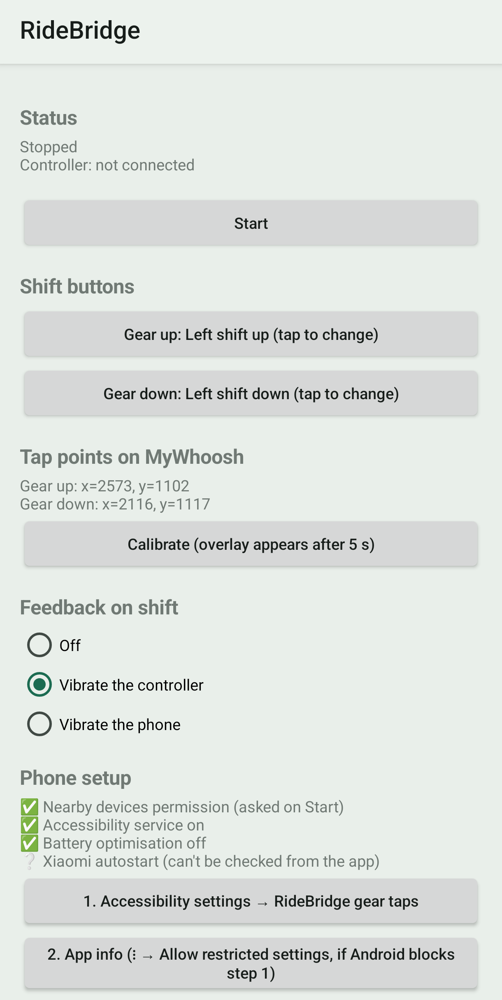
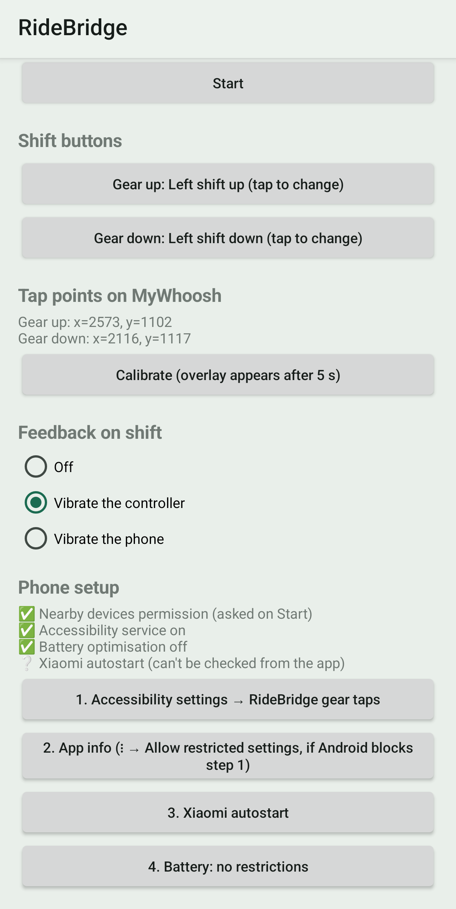
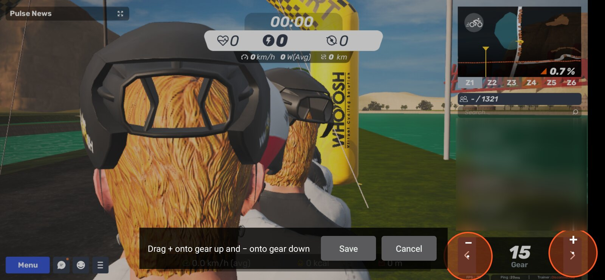

# RideBridge

Shift gears in [MyWhoosh](https://www.mywhoosh.com) with your **Zwift Ride** shift buttons, on a single Android phone.

RideBridge listens to the Ride's shift buttons over Bluetooth and taps MyWhoosh's on-screen virtual-shifting
**+** / **−** buttons for you. MyWhoosh keeps its own connection to your trainer; RideBridge never touches it.

> **Disclaimer**
>
> - This app was written with AI assistance (Claude), and the code has **not been thoroughly reviewed** by a human.
>   It is a personal project, provided as is, with no warranty. Read the code before trusting it and use it at your own
>   risk.
> - It **requires enabling an Android accessibility service**. This is a sensitive permission that lets an app
>   perform gestures (here, taps) on your behalf. RideBridge's service is only meant to tap MyWhoosh's gear buttons and
>   does not read the screen, but you should only enable it if you are comfortable with that.

  
  &nbsp;&nbsp;
  

   
  <em>Calibration: drag the two markers onto MyWhoosh's gear buttons.</em>

## How it works

- Connects to a Ride hood, **left** (manufacturer data `0x094A` / first byte `0x08`) or **right** (first byte `0x07`),
  whichever is found first (or the one you pinned). On a Ride v1 (firmware below 1.3) the left hood reports the buttons
  of both hoods; the Ride v2 may need each hood connected separately, which is not supported yet.
- Handshake and button decoding follow [BikeControl](https://github.com/jonasbark/swiftcontrol). Its current code is
  under a non-commercial licence, so this is an independent Kotlin re-implementation of the protocol for personal use.
- Taps are sent by an Android **AccessibilityService** (`dispatchGesture`). The calibration overlay is an
  accessibility overlay, so no "draw over other apps" permission is needed. The service reads nothing from the screen.
- A foreground service keeps the Bluetooth connection alive while MyWhoosh is in front.
- No third-party dependencies: plain Android framework and the Kotlin standard library.

Only gear up and gear down are handled. You choose which physical buttons they are, and both may be on the same side.

## Requirements

- Android 13+ (minSdk 33). Developed and tested on a Xiaomi Redmi Note 13 Pro, Android 16, HyperOS 3.
- A Zwift Ride controller.
- MyWhoosh on the same phone, in landscape, with **virtual shifting** enabled.

## Known risk

A Zwift Ride on firmware **1.3.0+** hides its Zwift service until Zwift unlocks it (about a day per unlock). The app
shows the firmware version and a clear message in that case. Unlocking is not implemented.

## Install

1. Download `ridebridge-<version>.apk` from the [latest release](../../releases/latest) and open it on the phone.
   Android will ask you to allow installing apps from this source.
2. Or build it yourself and install it with `adb`: see [CONTRIBUTING.md](CONTRIBUTING.md).

Updates install over the previous version as long as they come from the same release signing key.

## First run on the phone

1. Open RideBridge and tap **Start**. Allow *Nearby devices* and notifications.
2. Work through the **Phone setup** checklist (screenshot above):
   1. Accessibility settings → enable *RideBridge gear taps*.
   2. If the toggle is greyed out: App info → ⋮ → **Allow restricted settings**.
   3. Xiaomi **autostart**: allow it.
   4. Battery: **no restrictions**, otherwise HyperOS kills the service once MyWhoosh is in front.
3. Wake the Ride. The status should reach **Ready** and show the firmware version.
4. Press each shift button once: "Last: Pressed …" shows what the app sees. Use the **Gear up / Gear down** buttons to
   learn the ones you want (defaults: left shift up / left shift down).
5. Pick the feedback you want on each shift: off, controller vibration (default) or phone vibration.

## Calibration

1. Start a ride in MyWhoosh (landscape, virtual shifting on) so the gear buttons are visible.
2. In RideBridge, tap **Calibrate**. The overlay appears after 5 seconds.
3. Switch to MyWhoosh, drag the **+** marker onto the gear-up button and the **−** marker onto gear-down, then tap
   **Save**.

The saved coordinates are shown under *Tap points on MyWhoosh*. Calibrate again if you change MyWhoosh's layout or the
phone's display size.

## Troubleshooting

- `adb logcat` shows what the app sees and does.
- The controller vibrates on shift but MyWhoosh doesn't shift: the Bluetooth side works, so recalibrate the markers.
- No vibration and no shift: button events are not arriving; check that the status is **Ready**, and that only
  RideBridge (not Zwift or MyWhoosh's own pairing) holds the Ride's connection.
- The service stops after a while: check the autostart and battery steps above.
